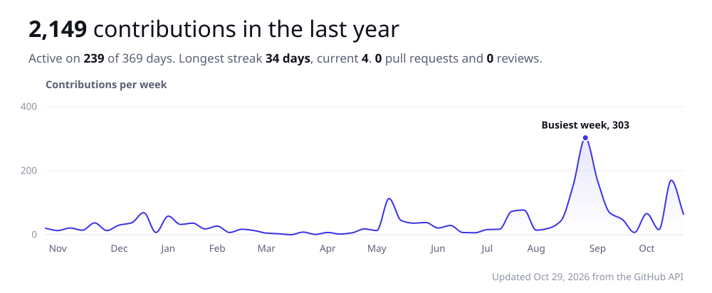
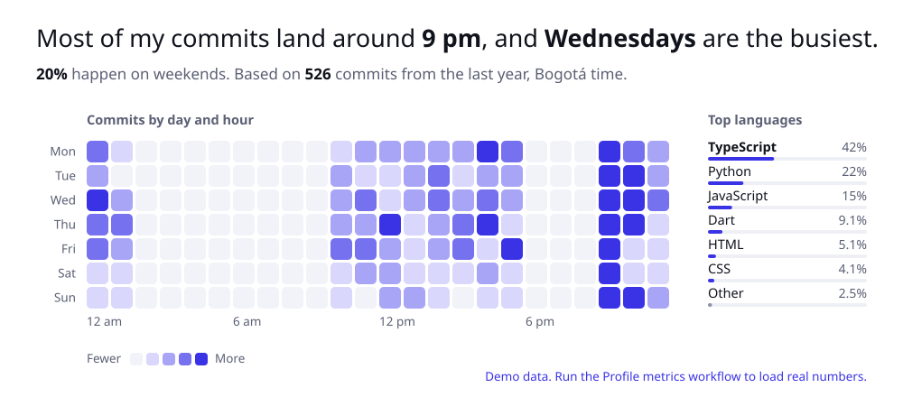

<picture>
  <source media="(prefers-color-scheme: dark)" srcset="./assets/hero-dark.svg">
  
</picture>

 

I build software where AI is part of the workflow, not a feature bolted on top: agents that decide what should happen next, running on event-driven backends that cost almost nothing at rest and scale when it matters. I care about the interface as much as the infrastructure, so most of what I ship starts with a design system and ends with a queue.

Working between Mexico and Colombia. [Email](mailto:beltrangonzalezdavid@gmail.com) or find me on [LinkedIn](https://linkedin.com/in/david-beltran-gonzalez).

 

<picture>
  <source media="(prefers-color-scheme: dark)" srcset="./assets/stack-dark.svg">
  
</picture>

### Where I've shipped

| | Role | What I built |
|:--|:--|:--|
| **Actioners** | Founding engineer | An AI coach that turns conversation into the next action to take. I own the full technical build: agent infrastructure, fine-tuned models, the API and the mobile app. |
| **Cuidalia** | Co-founder, CTO | A marketplace that connects families in Colombia with verified caregivers: onboarding, verification, matching, booking and payments. |
| **Belong** | Technical founder | A rental platform for Mexico and Colombia. Built the web and mobile MVP, an event-driven backend with GraphQL APIs, and AI-assisted dev workflows. |
| **FuzzyFlags** | Full-stack engineer | Next.js and MedusaJS production systems. Shipped an MIT initiative MVP in four weeks. |
| **Yuju** | Backend engineer | Serverless marketplace APIs for 75+ sellers on Lambda, DynamoDB and SQS. |

 

<picture>
  <source media="(prefers-color-scheme: dark)" srcset="./assets/activity-dark.svg">
  
</picture>

<picture>
  <source media="(prefers-color-scheme: dark)" srcset="./assets/rhythm-dark.svg">
  
</picture>

### What I'm working through

- Multi-agent systems that hold up in production, not just in demos
- Closing the loop between what an agent recommends and what the person actually did
- AI-assisted debugging and observability for serverless systems
- Small internal tools that save a team hours every week

 

Every chart here is drawn by a script in this repo, no third-party widgets. A GitHub Action redraws the metrics every morning.
